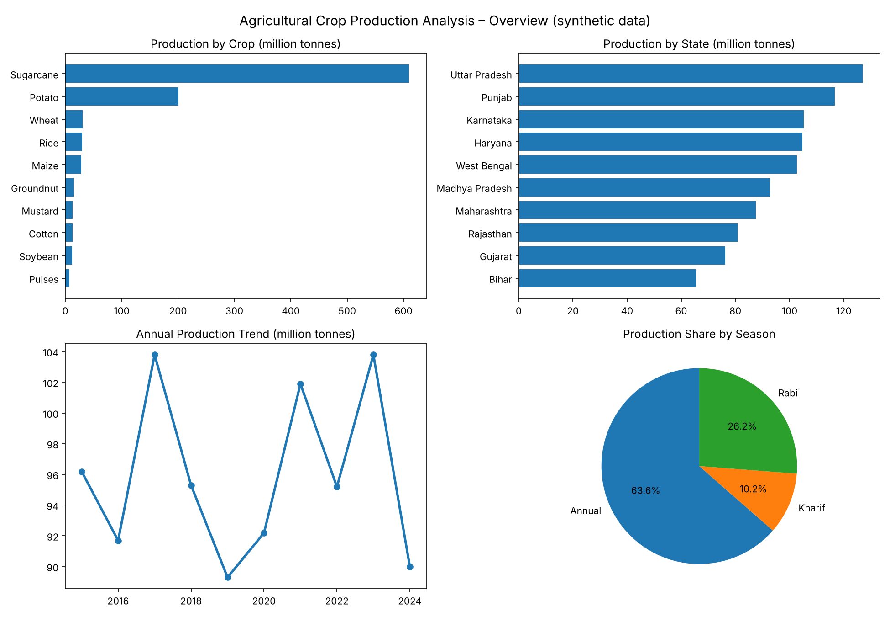

# 🌾 Agricultural Crop Production Analysis using Python and Power BI


An end-to-end data analytics project that turns raw crop records into summaries, charts and an interactive dashboard.

**Program:** IIOT-3 – Introduction to Data Analytics · **Mentor:** Puneet Sir
**Institution:** Invertis University, Bareilly · Center for Skill and Entrepreneurship Development (CSED) · B.Tech CSE, Section F

> ⚠️ **Data limitation:** the dataset in this repo is **synthetic** (generated by `generate_data.py` with a fixed random seed). It is not official government data and must not be used to make real-world agricultural claims.



## Table of contents

- [Problem statement](#problem-statement)
- [Objectives](#objectives)
- [Features](#features)
- [Project structure](#project-structure)
- [Quick start](#quick-start)
- [Dataset](#dataset)
- [Methodology](#methodology)
- [Key results](#key-results)
- [Power BI dashboard](#power-bi-dashboard)
- [Future scope](#future-scope)
- [Team](#team)
- [License](#license)

## Problem statement

Agricultural production data is usually spread across large tables, which makes it hard to compare crops and regions, spot year-wise trends, or choose a fair way to measure yield. This project builds a **repeatable analysis pipeline** and dashboard so updated data can be analysed the same way every time.

## Objectives

- Load, inspect and validate crop production data with Python
- Calculate **total production**, **total area** and **weighted yield**
- Compare production across crops, states, seasons and years
- Explore rainfall, fertilizer and irrigation against yield (association, not causation)
- Build an interactive Streamlit dashboard
- Provide a Power BI-ready CSV, DAX measures and a dashboard design guide

## Features

- ✅ Reproducible synthetic dataset (1,000 records · 10 states · 10 crops · 2015–2024)
- ✅ Command-line analysis that prints KPIs and saves charts + summary tables
- ✅ Streamlit dashboard with filters (Year, State, Crop, Season), KPI cards, 4 tabs and CSV export
- ✅ Power BI measures (`.dax`) and step-by-step build guide

## Project structure

```
crop-production-analysis/
├── data/
│   └── crop_production_india_sample.csv   # synthetic dataset (1,000 rows)
├── outputs/                               # charts (PNG) and summary tables (CSV)
├── images/                                # picture used in this README
├── powerbi/
│   ├── DAX_Measures.dax                   # copy-paste Power BI measures
│   └── PowerBI_Dashboard_Guide.md         # how to build the dashboard
├── generate_data.py                       # creates the dataset
├── analysis.py                            # command-line analysis
├── app.py                                 # Streamlit dashboard
├── requirements.txt
├── LICENSE
└── README.md
```

## Quick start

```bash
# 1. Clone the repository
git clone https://github.com/<your-username>/crop-production-analysis.git
cd crop-production-analysis

# 2. (Recommended) create a virtual environment
python -m venv .venv
source .venv/bin/activate        # Windows: .venv\Scripts\activate

# 3. Install dependencies
pip install -r requirements.txt

# 4. Run the analysis (prints KPIs, saves charts to outputs/)
python analysis.py

# 5. Launch the interactive dashboard
streamlit run app.py
```

To regenerate the dataset from scratch: `python generate_data.py`

## Dataset

Each row is one **state–crop–year** combination.

| Field | Description |
|---|---|
| `Year` | Observation year (2015–2024) |
| `State` | Indian state represented |
| `Crop` | Crop category |
| `Season` | Kharif, Rabi or Annual |
| `Area_Hectares` | Cultivated area in hectares |
| `Production_Tonnes` | Crop production in tonnes |
| `Yield_Tonnes_per_Hectare` | Yield per hectare |
| `Rainfall_mm` | Illustrative rainfall value |
| `Fertilizer_kg_per_ha` | Illustrative fertilizer input |
| `Irrigation_Coverage_Percent` | Illustrative irrigation coverage |
| `Soil_Type` | Broad soil category |

## Methodology

```
CSV dataset → Load with pandas → Validate / prepare → Filter records
   → Aggregate production, area, yield → Create charts
   → Streamlit dashboard / Power BI visuals → Interpret results
```

**Why weighted yield?** Averaging the yield column treats every row equally, so a tiny field counts as much as a huge one. It's like a course grade: a quiz and a final exam shouldn't carry the same weight. Instead we divide total production by total area:

```python
weighted_yield = df["Production_Tonnes"].sum() / df["Area_Hectares"].sum()
```

## Key results

*(Synthetic sample — for demonstrating the workflow only.)*

| Metric | Value |
|---|---|
| Records | 1,000 |
| Total production | 959.35 million tonnes |
| Total area | 80.74 million hectares |
| Weighted yield | 11.88 tonnes / hectare |

Production share by season: **Annual 63.6%**, **Rabi 26.2%**, **Kharif 10.2%**. More charts are in [`outputs/`](outputs/).

## Power BI dashboard

Import `data/crop_production_india_sample.csv` into Power BI Desktop, add the measures from [`powerbi/DAX_Measures.dax`](powerbi/DAX_Measures.dax) and follow [`powerbi/PowerBI_Dashboard_Guide.md`](powerbi/PowerBI_Dashboard_Guide.md). 

## Future scope

- Replace synthetic data with verified official datasets (document source and licence)
- Add more years, districts, crops and finer seasonal categories
- Integrate weather and market-price data
- Add forecasting models with proper train/test evaluation
- Deploy the dashboard to a cloud service
- Add maps and district-level drill-down

## Team

B.Tech CSE · Section F · Mentor: Puneet Sir

Abdus Samad · Vishnu Yadav · Mani Katare · Arun Sharma · Daniyal Khan · Rajesh Kumar Prajapati · Ansh Singh · Khushi Chauhan · Abneet Verma · Deepansh Pal · Shrey Raghav · Aditya Singh · Prabhakar Gangwar · Amit Kumar

## License

Released under the [MIT License](LICENSE).

## Acknowledgements

Thanks to the developers of Python, pandas, Matplotlib, Plotly, Streamlit and Microsoft Power BI.
